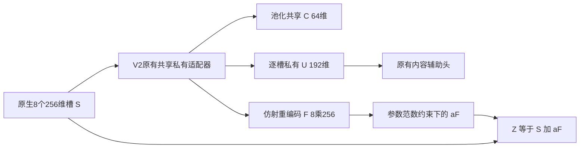

# 有界原槽残差：接口验收、计算代价与语义旁路

本轮基点：`a03a4fb2b4ccea3d9c234e4ef9ac130e604ff513`。上一轮属于进展：完成V2信息丢失与summary-HSIC数学审查，而非等待训练。这轮将其中一个候选落实为独立、可反向传播的适配器，并验证它的能力边界。

**决定：接口验收通过，保留为信息保留对照；不能把它与HSIC组合直接升级为新的共有／私有互信息方法。** 可逆、低HSIC、预测可读这三个条件，仍允许共有／私有分支都不含任务信息。本轮不继续扩展范数变体、不新增神经训练或患者入口。下一研究门槛是可检验的任务相关分工。

## 1. 实现范围与网络位置

新文件`slotspe_proof/bounded_native_residual.py`中的`BoundedNativeResidual`包住**未经修改**的`SharedPrivateSlots`。原版第三方、现有V2、主研究网络、预设与调度器均不变。没有注册新的患者命令，也没有把它混入anti-collapse／SCM／SRO。

单模态组件为：

槽数仍是每模态8个；共享C不是跨模态共识标签，U也没有被证明只保留独有信息。默认单模态175072参数，与原V2相同；有界残差不增加可训练矩阵。它只规定槽接口，不是一套已完成的生存网络。

直接调用返回Z及原C/U/content、分支F、残差系数和上界。使用已有`SlotPluginHost`做**生成backbone测试**时，原host按原约定把`base_latent`记为adapter输出Z；没有修改这个已有字段约定。测试中手工替换parts，未新增持久预设。当前state_dict含wrapper层级及严格配置字段，不承诺与旧V2 checkpoint直接兼容；本轮没有读任何患者checkpoint。

## 2. 上界、归一化和梯度选择

令F(S)_k=M mean(S)+NS_k+b，M=P_sA_s、N=P_uA_u。精确实数条件下，槽张量算子范数为max(||N||2,||M+N||2)。实现默认用可直接证明的上界

\[
B_c=\max\{\|N\|_F,\|M+N\|_F\},\qquad
a=\frac{0.5}{(1+10^{-4})\max(1,B_c)},\quad Z=S+aF(S).
\]

因此理想实数运算下残差Lipschitz常数小于0.5，输入距离至少保留约0.5倍。推导与上一轮相同，不是新可逆性定理。范数在float64中求值，a在前向乘法时转回输入dtype，最终Z保持输入dtype。1e−4是工程数值裕量，**不是对浮点误差的区间证明**。巨大偏置、有限精度与上游信息丢失仍不在这个数学结论中解决。

成本对照采用另一有效上界

\[
B_f=\|P_u\|_F\|A_u\|_F+\|P_s\|_F\|A_s\|_F.
\]

它避免合成两个D×D矩阵，但更保守。两个上界各有明确数学意义，未按预测分数挑选。没有用有限幂迭代近似值声称严格上界。

本轮选定**对参数依赖的a和范数计算求导，不detach**。a与当前患者输入无关，没有由患者内容产生动态槽选择。任务梯度经Z的恒等路径回S，也经a、F回共享／私有encoder及projection；任务不直接训练content_head。内容loss仍只经U的内容头回私有encoder，目标detach。参数归一化的导数会耦合适配器权重，但不把患者的8槽当8个批样本。

只验收float32／float64，显式拒绝half／bfloat16及autocast。CPU通过不能宣称CUDA、AMP或服务器吞吐已验收。`inverse()`是同参数状态下的解析线性求解诊断，不是建议投入预测的解码头；权重变化后不能拿旧Z与新逆配对。

## 3. API与数值验收

`tests/test_bounded_native_residual.py`含14个参数化测试项，连同原先7项边界测试，共**21 passed in4.06s**。首版20项通过后增加了下述语义反例，最终21项通过；没有用这些已知答案测试声称独立效果预注册。未重跑全仓库测试。

覆盖：

- 两默认初始化、两dtype下的8×256输出形状、旧零空间扰动保留、真实算子范数与解析逆。
- 槽置换等变、系数不随患者输入变化；内容和任务梯度路径分离。
- 在归一化激活时，用中心有限差分核对含系数导数的参数梯度，不只检查梯度非零。
- 零权重和100倍权重压力下的有限梯度、残差最小奇异值下界与恢复。
- 调用者CPU RNG不变；内存中的生成state_dict往返与配置不匹配拒绝；低精度／autocast边界。
- 真实已有hook在生成backbone上的接入、解析恢复和hook清理；不是原版患者生存头。
- 同参数精确逆读出可使主任务对适配器梯度抵消，以及共有／私有只编码无关因素的反例。

独立汇总在两种子、float32／64、生成B=1／8下核对上界。默认复合Frobenius上界约7.47–7.53，实际谱范数约1.26–1.28；实际残差收缩因子0.08386–0.08537。全单元恢复误差最大2.38e−7（float32），远低于预设2e−6门槛。不是临床特征保真率。

## 4. 24个成本单元的实际结果

协议在看计时前写入`bounded_residual_plan_20261102.json`：2个初始化种子×2种dtype×2个生成batch大小×原V2／Bc／Bf，共24个**计时单元，不是24次训练**。每单元5次预热、15次计时，均执行前向和反向，不做任何参数更新。Python3.10.11、Torch2.6.0+cu124，实际device=CPU，2线程。

下表是两个种子各自中位时间的范围；相对倍数使用同种子／dtype／batch的原V2配对，不是范围端点相除。原始15个计时值逐项保存在回执，未筛掉慢值。

| dtype／生成batch | 原V2毫秒 | Bc残差毫秒（倍数） | Bf残差毫秒（倍数） |
|---|---:|---:|---:|
| float32／1 | 1.1295–1.1894 | 4.1822–4.4314（3.52–3.92） | 2.2745–2.3785（1.91–2.11） |
| float32／8 | 1.6789–1.7127 | 4.8572–5.1249（2.89–2.99） | 3.1867–3.3273（1.90–1.94） |
| float64／1 | 1.1464–1.2230 | 3.7242–3.9241（3.21–3.25） | 1.9648–2.1391（1.71–1.75） |
| float64／8 | 2.1115–2.1925 | 5.2212–5.3674（2.38–2.54） | 3.2851–3.3477（1.53–1.56） |

计时包含zero_grad、适配器forward和平方均值的backward；不含真实主干、生存loss、内容匹配／HSIC、数据IO、优化器、精确SVD诊断或解析inverse。生成B=8矩阵调用不能冒充患者训练器的逻辑batch实现。微秒／毫秒有系统抖动、未随机化执行顺序、仅一次本机基准，不估计显著性或GPU耗时。

Bc初始化输出变化L2范数仅为原槽L2的2.32%–2.46%；Bf为0.149%–0.159%。后者实际收缩因子约0.00542–0.00548，比Bc更接近恒等。上界保守度与成本有实际折中，但这些比例不是槽利用率，也不是训练后分工证据。不能由“更便宜”推断Bf更适合预测。

总计505次源码adapter forward（含每单元一次静态诊断和语义控制一次，不含测试fixture）；其中480次用于计时／预热反向，另一次语义控制做score autograd。新增优化器更新0、神经训练0。全部计时区间合计1.123秒，不包含预热、测试、诊断和进程启动，不能作为本轮总耗时。

## 5. 语义反例：保留任务信息但分解仍可全部无关

精确枚举8个状态(Y,N1,N2)：Y、N1∈{−1,1}，N2∈{0,2}，独立均匀。每位假想患者的4个8维槽为(Y,N1,N2,0,…,0)，设置现有encoder使C只取N1、U只取N2。其余projection及内容头仍为固定初始化，未训练。

此时C/U均跨患者变化，实际源码的所有矩标准化检查通过；C与私有全集本就独立，summary-HSIC=2.60e−18，共享方差项=0。但在声明的有限总体中

\[
I(Y;C)=I(Y;U_{1:4})=0.
\]

相同N1/N2而Y相反的两组，原V2输出F逐位相同。残差Z保留区别，组间槽张量距离为4。声明的特权逆头`mean(inverse(Z))`第一坐标恢复Y，误差1.11e−16；对adapter的score梯度最大5.55e−16。这验证的是存在性：一个有足够能力的读出可以通过原槽通路取得任务信号，同时分解分支完全没有Y。**不证明普通有限Deep Sets头实际学到了这个逆，也不是把逆头推荐为新读出。**

这里没有调用实际ContentReference或证明其内容loss也能最小；故不把反例说成完整既有目标的全局最优解。它证明“低HSIC＋有界原槽残差＋预测可读”本身不足以确立有益共有／有害私有。8行是精确枚举的总体，不是8位真实患者，更不是把一人的4槽当4个独立样本。

## 6. 对完整路线的约束与下一决定

| 问题 | 方法作用 | 可检验预测 | 对照 | 结果如何解释 |
|---|---|---|---|---|
| 重编码接口不可逆 | 有界原槽残差保留固定S的信息 | 原零空间碰撞能区分且可恢复 | 原V2、普通残差抵消、S直通 | 本轮通过；只接受接口，不接受患者效果或语义 |
| 预测绕过解耦 | 明确记录C/U任务增量与原槽通路作用 | C/U必须有超出匹配无关／复制基准的任务可读内容 | 固定编码器和头容量、 nuisance分解、原槽直通、条件替换 | 本轮给出失败反例；下一机制须显式处理，不能只看整体分数 |
| 全槽读取未证明 | 另轴研究无动态槽权重的对称聚合 | 同训练路径、相同选权下的全槽内容和预测变化 | 原版含全cross路径的读出、均值、Deep Sets、关系+容量对照 | 本轮没有替换临床读出或运行此矩阵；可逆槽接口不保证均值之后保真 |

自主决定：本轮不继续优化范数和残差增益，不因接口通过就启动新一批训练。把该组件固定为**原生信息保留控制**，回到任务相关分工的核心机制审查。下一候选必须同时说明：患者样本单位、跨模态共有的观测锚、允许有用私有及协同的任务增量、噪声／复制／重编码控制、读出如何实际使用分解。已有KL扫描的负结果与本轮旁路结果都必须保留。

尚未完成：新的可识别MI目标、完整新网络的机制效力、稳定预测增益、患者适配和独立评估。任何后续合成训练须先有能分辨已知答案的语义验收；患者阶段另需授权、匹配split与随机调度，并隔离训练／模型选择／独立测试。20次固定checkpoint评估仍不是20次训练。

## 7. 文献、回执及保护范围

可逆残差与范数约束属于已有方法族，原论文与作者实现见[Invertible Residual Networks, ICML2019](https://proceedings.mlr.press/v97/behrmann19a.html)和[官方实现](https://github.com/jhjacobsen/invertible-resnet)。当前适配器用的是仿射槽均值／对比结构的Frobenius上界；没有移植完整i-ResNet，没有训练生成模型或估计其似然。这不构成一般可逆网络创新或MI语义证明。近期共享私有／信息瓶颈近邻仍按既有文献报告分层，本轮没有完成新的全面近年检索。

计划、raw与验证分别为：`bounded_residual_plan_20261102.json`、`bounded_residual_receipt.json`、`bounded_residual_validation.json`。旧报告和raw回执不改，只有研究导航README及新增PROGRESS条目随本轮更新。

本轮只读远端两个研究分支，均仍为`0245876bdfa0e2f3d04b14eff54248dc1444e6f5`；无新远端状态变化。本地研究工作树与远端分叉，未合并、未推送、未操作服务器。旧服务器报告的患者数组及checkpoint没有在本轮验收，不能据此更新anti-collapse或新方法的患者结论。

六项交付：路线／任务=有界残差接口及语义边界；完成=独立组件、14新测试项、24成本单元、8状态旁路反例；路径／提交=本文及同目录回执／本次Git提交；检查／实际执行=21项通过与505次生成adapter前向、零优化；缺口=任务分工和MI机制未成；下一步=以任务相关分工重新审查候选，保留该组件作控制，患者与队列不动。
