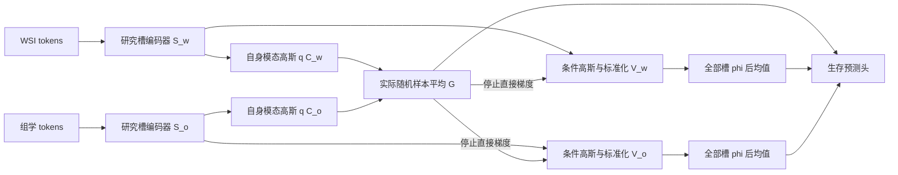

# 共享条件瓶颈与全槽私有预算：实现、消融与边界

2026-11-02，父提交 `5cf76b7`。本阶段完成新的共享随机通路、36个高斯解析核查、48次锁定合成训练、6组XOR仪器正负控和68项相关单元测试。**共享通路的私有信息可读性得到受控改变，但预测分数未稳定改善，私有协同与多槽互补仍未验收。**保留该实现为可审计的研究基础，不称为最终投稿方法。

## 1. 实际网络是什么

本网络是独立的共有/私有研究原型，不是原版SlotSPE的源码改动，也不是已对齐的V2患者实现。输入为预提取token，没有患者加载器或队列入口。

| 部分 | 默认设计 | 本次实际验收 |
|---|---|---|
| 每模态研究编码槽S | 8槽×128维，3轮竞争注意力/GRU | 4槽×16维 |
| 共享高斯后验 | 每模态一个32维均值与对数方差 | 每模态4维 |
| 共享读出G | 两个实际随机C样本平均，32维 | 4维 |
| 私有槽V | 每模态8槽×32维 | 每模态4槽×4维 |
| 聚合 | 每槽加患者无关的学习常量，经同模态共享phi，所有槽均值 | 相同方式 |
| 输出 | 4个时间箱logits | 4个时间箱logits |

默认仍是WSI 8槽＋组学8槽；另外有两组共享高斯参数和一个平均共享向量。S是这些私有槽的上游表示，不把坐标变换前后重复计作另一批槽。共享向量不是额外8个共享槽。当前没有内容PCA头，没有预测Top-K、动态注意力权重或关系模块。构造槽时的token竞争注意力仍然存在。

角色常量仅为槽索引参数，没有人工语义；“槽与常量编号一同置换”不变性通过测试，不宣称无标签槽任意置换不变。全槽参与结构不代表头使用了每个槽的独立信息。所有四臂均为7444参数的小模型；默认大模型与GPU未验收。

## 2. 一个瓶颈原则中的两类变量

共享后验严格只见自身模态：`q(C_w|X_w)`与`q(C_o|X_o)`。双向平均rate为

\[
R_C=\tfrac12 E[KL(q(C_w|X_w)\|q(C_o|X_o))
                    +KL(q(C_o|X_o)\|q(C_w|X_w))].
\]

两个分布使用同一共享坐标，但参数来自各自模态。对于固定网络、正规密度、有限项及Markov关系`C_w−X_w−X_o`，单方向rate分解为

\[
E KL(q(C_w|X_w)\|r(C_w|X_o))
=I(C_w;X_w|X_o)+E_{X_o}KL(q(C_w|X_o)\|r(C_w|X_o)).
\]

本实现以另一模态共享后验作为r，解析计算对角高斯KL；没有负样本估计器，不把同一患者的多个槽当作独立患者。低KL仍可能来自常量编码、噪声增加或内容丢失，不能直接称为真实互信息降低或有益共有信息。

私有后验与条件先验沿用上游研究结构，输入各模态S及`sg(G)`。实际V为先验均值/尺度标准化后的随机变量，逐槽rate为

\[
R_{mk}=E_{A,G}KL(q(V_{mk}|A,G)\|N(0,I)),\quad A=(X_w,X_o).
\]

由于G现在也随机，应把`(A,G)`视为扩展随机输入；恒等式给出`R_mk = I(A,G;V_mk)+KL(q(V_mk)||N0)`，不能直接沿用“G是A确定函数”的旧推导。它上界总编码信息，也可能压掉有用信息，不保证只删冗余。私有采样在给定输入/G下独立，组rate还包含聚合后验总相关等项；非零经验rate不提供语义独立证明。

固定损失为

\[
L=L_{surv}+.1L_{cross}+\lambda_C R_C
  +\lambda_V\operatorname{mean}_{m,k}[\widehat R_{mk}-1]_+.
\]

共享权重0/.1、私有权重0/.3构成2×2消融。rate均按潜变量维求和后以nat记账，没有把旧的按维平均beta混用；私有项仍是批次均值的软预算，不是总体/逐患者硬上限。共享/私有原始高斯对数方差截断[-8,4]，V的相对方差按两者之差计算。

## 3. 实际预测路径与梯度

预测头、共享cross预测都使用实际C随机样本；没有无噪声均值旁路。后验均值只作为单独诊断输出，训练objective拒绝均值模式。eval默认也随机；给定全部噪声时结果逐位重复，不消耗额外全局CPU RNG。

共享KL同时更新两个自身模态后验；生存重参数化梯度到共享均值/方差、全部私有槽及读出。私有预算不直接更新共享头，因为G停止梯度；共享/私有仍共用各自槽编码器，参数间接耦合保留。单元测试验证这些具体路径，而非患者效果或网络最优性。

**多次采样边界：**单方向信息界针对单次随机C_w及给定X_o的条件信息；该变量n次条件独立调用的KL按n倍记账。一般不能把双方向平均R_C解释成G的总体互信息上界，更不能用单次rate不变地约束多次平均预测或精确后验预测期望。解析二元例子中，单次rate趋零时，随机样本判别接近机会水平，但无噪声均值仍能恢复比特。当前评估是分别计算5次随机前向的NLL后取均值，不是对logits/hazard平均后再计算NLL，也不是5次训练。均值模式分数单独登记，不能拿它支撑单次样本的信息论结论。

## 4. 已完成的48次训练

预先计划见 `crossmodal_conditional_rate_plan_20261102.json`。4任务×3种子419/431/449×4臂，每臂500次Adam更新，lr=.003、batch32、512名合成训练样本，CPU 2线程，无裁剪。固定末步，无验证选权。探针fit/validation/test为192/128/384；核族/最佳单槽只用validation选择。共24000次核心更新，训练循环约391秒（不含探针、数据构造及工具开销）。12组初始化、48份合成缓存hash、执行前源码pins全部核验。

四臂数据、初始化、批次及显式共享/私有噪声一致。该矩阵隔离共享KL与私有预算；它没有隔离旧确定性G改为随机G的架构效应，也没有原版SlotSPE/V2公平基线。新数据的结果不与旧队列裸分数混合。

以下固定私有预算权重.3，比较共享KL开/关，均为三种子均值：

| 任务 | 共享KL | 生存NLL↓ | 共享单向平均rate(nat) | 实际G对预置WSI任务比特的线性R² | 实际私有聚合特征相对G的风险探针增量 |
|---|---|---:|---:|---:|---:|
| 仅共有量有用 | 关 | .8266 | 75.773 | −.009 | .002 |
| 仅共有量有用 | 开 | .8229 | .0627 | −.025 | .074 |
| 仅WSI私有比特有用 | 关 | .7841 | 297.607 | .859 | .002 |
| 仅WSI私有比特有用 | 开 | .7950 | .00371 | −.019 | .865 |
| 私有XOR协同 | 关 | 1.1614 | 174.178 | −.015 | .0007 |
| 私有XOR协同 | 开 | 1.1439 | .00962 | −.025 | .0024 |
| 共享干扰关系反转 | 关 | 3.3380 | 37.467 | −3.008 | .000 |
| 共享干扰关系反转 | 开 | 3.0411 | .0355 | −2.818 | .015 |

私有任务中，G的线性私有可读性显著变小，私有聚合特征的有限风险可读性上升，符合目标通路的受控预测。但不能据此证明信息已经因果转移；尚未做固定头的条件替换/删槽干预。该任务NLL方向还略差：差+.01087，描述性配对t95区间[−.03219,.05393]。不能把未分离当成非劣效证明。整个矩阵8个共享KL配对NLL差的三种子描述区间均跨0，未建立稳定预测优势。

仅共有量任务中，完整约束下实际G对真实共有量的线性R²约.884（无共享KL时.946）；但只开共享KL而不限制私有预算，实际G可读性降至.191，私有rate仍约12.7 nat/槽。说明内容可能转向另一路，不能只看共享KL很低。私有任务中，受约束的无噪声G均值仍对私有比特有约.372的线性R²，而实际随机G为−.019；这直接体现均值与样本口径的差别。

共享干扰任务在训练/探针fit/validation中H与WSI任务比特同向，test反向。H始终同时出现于两模态；因此预置WSI比特在该构造中不满足“给定共有量仍独立私有”的假设。负R²主要反映跨分布映射失败，不是没有信息。完整约束仍保留H（对H的实际G线性R²约.931），高test NLL表明该约束没有解决共享捷径。

## 5. 槽利用与协同没有随之成功

完整约束的XOR任务：私有均值坐标有效秩约1.32/1.40、槽余弦约.94/.94；随机私有槽有效秩却约3.08/3.12。随机噪声可以撑开几何，不等于保留内容。全槽相对验证选定的每模态最佳单槽增量仅约.0028，当前未建立稳定的槽间互补。

为核查仪器，使用原缓存的同一fit/validation/test行做6组正负控，未新增神经训练：真实两比特平铺为相同32维输入时，XOR风险增量最低.964；错配行负控最大.0052。相同宽度/核网格下能分辨干净XOR信号；不过正控是无干扰的低秩码，未匹配学习表示的全部噪声和有效复杂度，所以阴性仍只能表述为“当前探针未检出有效协同”，不能证明信息不存在。

这些任务每模态最多只需要一个私有任务因素；它们本身不足以验收8槽多因素互补。生存生成也主要使用一维潜在风险。不能把当前共享分支改善推广为“槽冗余已解决”。

## 6. 原论文/官方实现与创新边界

| 已有工作 | 本轮核对与关系 |
|---|---|
| [MIB，ICLR2020](https://arxiv.org/abs/2002.07017)；[官方mib.py](https://github.com/mfederici/Multi-View-Information-Bottleneck/blob/master/training/mib.py) | 官方`_compute_loss`已有双后验随机采样、对称KL和互信息项。当前共享正则并非新机制；这里用解析高斯KL、跨模态观测预测及删失生存目标，没有复现其完整MI估计/训练流程。 |
| [CEB](https://arxiv.org/abs/2002.05379) | 条件信息压缩及其变分参照已有理论来源；本阶段的恒等式/解析oracle不是原创定理。 |
| [DisentangledSSL，ICLR2025](https://arxiv.org/html/2410.23996v2) | 已明确以条件信息学习共享、并独立考虑特有信息覆盖及不可达MNI。当前私有支路优化联合任务损失与容量，不最大化全部特有内容，因此没有它的覆盖/最优性保证。 |
| [PIBD官方实现](https://github.com/zylbuaa/PIBD) | 已有预后任务的共有/特有与信息约束。无Top-K全槽读出、槽级容量和诊断边界是当前研究差别，仍不足以单独保证方法新颖性。 |

原理依据与患者效果必须分开。MIB的视图冗余假设不能直接套给病理/组学私有或协同任务；本次专门保留私有路径，但保留路径不意味着已学到全部互补信息。后续仍需对近邻作匹配实现/评估，不能保证全球首创或期刊级别。

## 7. 下一步的最小问题与行动

问题 → 私有XOR未检出协同，可能涉及编码内容丢失、池化可读性或优化；本轮没有分清三者。方法作用 → **先以已知因子替换编码，测试相同容量生存读出能否学会XOR**，再做固定头条件替换诊断。可检验预测 → 若干净因子读出能成功而学习表示失败，应优先修复内容保留/编码；若干净因子也失败，先审查训练/读出与生存目标，避免追加解耦损失。

备选受控增量是“给定G的逐槽内容预测”，目标优先考虑冻结观测分组的跨子袋内容而非最高方差单一PCA目标。数学上，若目标T=G，解码器同时见G和V时可令V常量；若T是真实私有P，则准确恢复仍需V携带条件信息。这能修正旧的V单独内容头主动复制共有量的问题，但不解决私有无关内容消耗预算、目标身份错误或真实语义不可识别，故当前**未加入模型、未训练、未验收**。

在上述仪器和内容门槛前不扩随机种子挑权重、不增加关系/注意力模块、不启动患者或服务器队列。患者阶段仍需原版、V2_content、V2_separate与候选在相同split/路径/patch/选权规则下比较，并另设独立测试或嵌套选择。当前48次为探索，不作为独立确认。

相关文件：`slotspe_proof/crossmodal_shared_bottleneck.py`及本目录`crossmodal_conditional_*`回执；68项相关测试通过，未重跑全仓测试。同时修正了旧诊断模块中把线性残差称作条件增量答案、把读出扰动称作患者因果干预的误导性说明；数值实现与历史回执保持原状。所有合成数组在忽略目录，患者训练/推理/患者checkpoint读取/服务器执行均为0。

## 8. 本轮读到的远端反塌缩补充报告

远端研究分支新增`1c9a9bf2ea3570cee5ecf617ed16d43b7e175875`，已只读获取其公开[聚合报告](https://github.com/LDT-von/slot-attention/blob/1c9a9bf2ea3570cee5ecf617ed16d43b7e175875/docs/research/slotspe_queue_results_20261102/results.md)、`results.json`和汇总函数源码，没有合并、执行汇总脚本或读取底层患者工件。

报告的已训练fold0–2中，A0/A1 WSI有效秩5.54–6.81、余弦.096–.192；自身重构优于供体的比例A0为.630/.771/.893，A1为.860/.799/.863。公开JSON还给出WSI donor/own均值比约1.033–1.320，组学约1.006–1.015。这是值得保留的正向报告证据：**该供体扰动下，WSI槽集合的自身重构优势更强**；与生存分数不改善可以同时存在。

对报告中更强的“内容分离成立”“槽不再塌缩”解释，本研究采用较窄表述：

- 汇总函数仅统计`own_mse < donor_mse`。比例高于.5不自动证明独立信息、槽间互补或预后内容；还需供体构造、正负控、效应量与测量分辨率。当前没有重新审计原始行或这些校准条件。
- 每折1500–1540是“患者×20复评”行数，不是独立患者/独立训练数；不能直接据此做独立二项显著性推断。自身优于供体的槽集合也可能每槽都复制相同患者信息。
- 新表是诊断均值，不能仅靠它证明整个训练历程从未塌缩；“全部训练过程”还需完整逐轮记录。队列仍只有前三折结果，未变为完整五折验收。
- A0/A1基于R5。与S0同评估协议的差别可以描述，但裁剪/衰减的独立效果仍需相同R5父臂的协议对齐；不能直接迁移到本轮高斯共享模型或V2。

因此，这次补充支持继续研究反塌缩的内容效应，但尚不足以冻结V2干预参数或启动患者迁移。原报告及其历史措辞保持原字节，独立限定记录于此。
